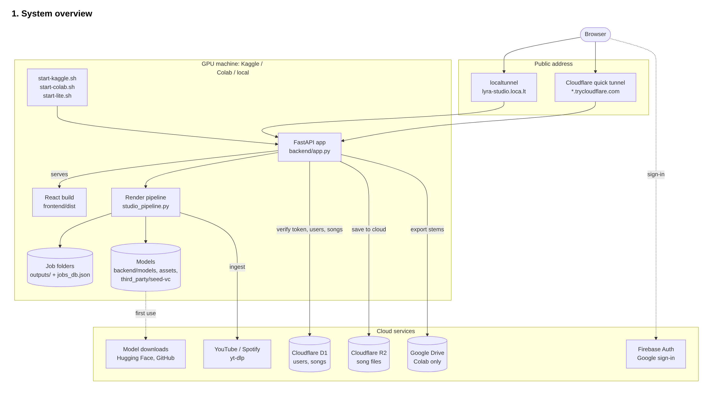
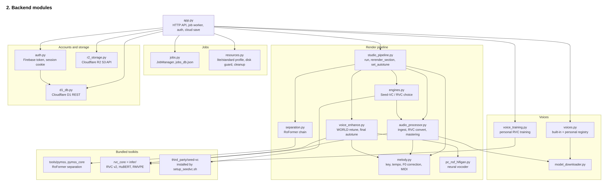
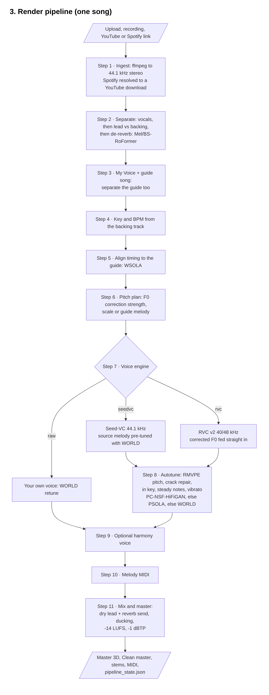
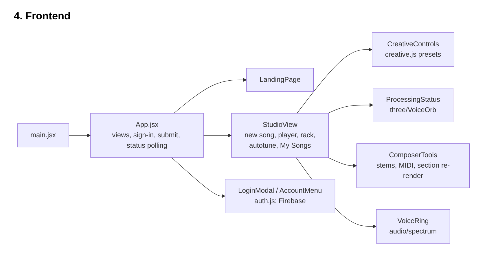

# Lyra

AI vocal studio to transform singing takes, polish pitch and timing, and export stems.

## Quick Start

```bash
# install dependencies
pip install -r backend/requirements.txt

# start in lite mode (great for macs or lower ram)
./start-lite.sh

# or start for full development
cd backend && python -m uvicorn app:app --port 8000
cd frontend && npm run dev
```

Open `http://localhost:8000` (or `http://localhost:3000` in dev mode) in your browser.

## Cloud Setup

### Google Colab
Run in a GPU notebook:
```python
!git clone https://github.com/harmanD-MAX/Lyra.git
%cd Lyra
!bash start-colab.sh
```

### Kaggle
In a notebook with GPU T4 enabled:
```python
!git clone https://github.com/harmanD-MAX/Lyra.git /kaggle/working/Lyra
!bash /kaggle/working/Lyra/start-kaggle.sh
```

## Features

- **Voice Transformation**: Sing or upload audio and hear it transformed with neural voice models.
- **Pitch Correction**: Natural autotune and timing correction.
- **Stem Separation**: Automatically split vocals, instrumental, and backing tracks.
- **Cloud & Local Storage**: Save songs locally, to Google Drive, or sync with Cloudflare R2.

## Architecture








